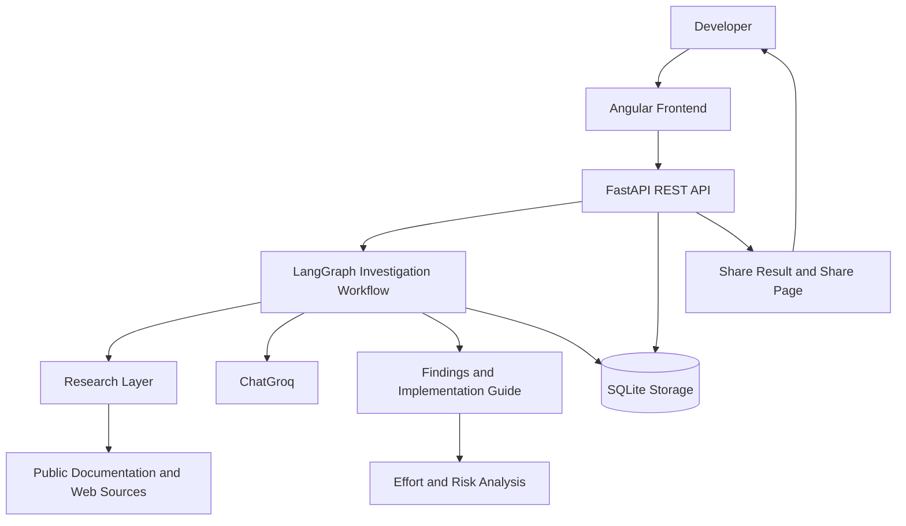
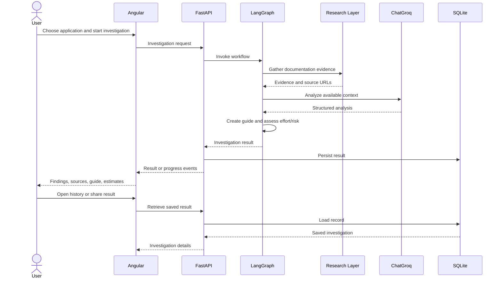

# OAuth Launchpad

**An AI-assisted OAuth integration investigation workspace**

OAuth Launchpad helps developers investigate an application's OAuth capabilities, gather documentation evidence, generate implementation guidance, estimate implementation effort and risk, and revisit or share investigation results.

The project combines a **FastAPI backend**, a **LangGraph investigation workflow**, **ChatGroq** for LLM reasoning, research utilities, **SQLite persistence**, and an **Angular frontend**.

> **Status:** The backend and frontend can be run locally. The Angular frontend is published on GitHub Pages, but the public frontend requires a separately reachable backend API for live operations.

## Contents

- [Problem Statement](#problem-statement)
- [Features](#features)
- [Architecture](#architecture)
- [Investigation Workflow](#investigation-workflow)
- [Technology Stack](#technology-stack)
- [Repository Layout](#repository-layout)
- [Prerequisites](#prerequisites)
- [Local Setup](#local-setup)
- [Configuration](#configuration)
- [Run Locally](#run-locally)
- [API Overview](#api-overview)
- [Evidence, Effort, and Risk](#evidence-effort-and-risk)
- [Persistence and Sharing](#persistence-and-sharing)
- [Testing and Evaluation](#testing-and-evaluation)
- [Deployment](#deployment)
- [Security and Limitations](#security-and-limitations)
- [Future Improvements](#future-improvements)

## Problem Statement

OAuth integration work often requires developers to navigate provider documentation, distinguish documented behavior from assumptions, identify configuration requirements, and turn scattered information into an actionable implementation plan. This can be especially difficult when the developer is unfamiliar with the provider.

OAuth Launchpad brings these tasks into one investigation workflow: research public documentation, structure findings and sources, generate a practical guide, estimate effort and risk, and save the result for later review.

OAuth Launchpad is an **investigation and planning assistant**. It is not an OAuth authorization server and does not replace testing an integration in the target provider's own environment.

## Features

- **Application catalog:** Browse the configured application/provider catalog.
- **Documentation research:** Gather source material relevant to an investigation.
- **AI-assisted investigation:** Organize research through a graph-based workflow using LangGraph and ChatGroq.
- **Structured implementation guide:** Present prerequisites and ordered steps, including optional steps where supported.
- **Evidence-linked findings:** Include source URLs so developers can inspect the material behind findings.
- **Effort and risk analysis:** Estimate active implementation time, complexity, confidence, and potential risk areas.
- **Investigation history:** Save completed investigations and retrieve them later.
- **Feedback:** Submit feedback on a saved investigation.
- **Shareable results:** Retrieve a share-oriented representation and render a share page for a saved investigation, where supported.
- **Angular UI:** Provide catalog, investigation, guide, history, and strategy-related screens.

Exact behavior depends on the current code, configured catalog, available environment variables, and whether the backend is running.

## Architecture



### Component responsibilities

| Component | Responsibility |
|---|---|
| Angular frontend | UI for catalog, investigation, guides, history, and related workflows. |
| `app/main.py` | FastAPI application entry point and HTTP endpoints. |
| `app/agent.py` | Coordinates the LangGraph investigation workflow. |
| `app/research.py` | Research and source-material retrieval/processing. |
| `app/catalog.py` | Configured application/provider catalog. |
| `app/guides.py` | Structured implementation-guide logic and validation. |
| `app/strategy.py` | Analysis-related logic, including effort/risk behavior where connected. |
| `app/schemas.py` | Structured request and response models. |
| `app/storage.py` | Persistence and retrieval of investigation records. |
| ChatGroq | Language-model reasoning used by the agent. |
| SQLite | Local storage for investigations and related records. |

The diagram is a high-level architectural view; exact node boundaries and call sequences can evolve with the implementation.

## Investigation Workflow



### Workflow stages

1. Select an application from the configured catalog or provide the investigation input supported by the UI.
2. Collect relevant documentation and source URLs through the research layer.
3. Analyze the available context through the LangGraph workflow and ChatGroq.
4. Structure findings into prerequisites and implementation steps.
5. Estimate effort, complexity, confidence, and risk areas.
6. Save the investigation for later retrieval.
7. Review the saved result, submit feedback, or use the share flow where supported.

## Technology Stack

- **Python** — backend language
- **FastAPI** — HTTP API
- **Uvicorn** — ASGI server
- **LangGraph** — workflow orchestration
- **ChatGroq / LangChain Groq integration** — LLM access
- **HTTPX and BeautifulSoup** — HTTP requests and HTML parsing, where used
- **Tavily** — web search integration, if enabled in the current configuration
- **SQLite** — local persistence
- **Angular and TypeScript** — frontend
- **GitHub Actions and GitHub Pages** — frontend build and static hosting

Python dependencies are listed in `requirements.txt`; frontend dependencies are managed in `oauth-launchpad-ui/package.json` and `package-lock.json`.

## Repository Layout

```text
oauth-launchpad/
├── app/
│   ├── __init__.py
│   ├── agent.py
│   ├── catalog.py
│   ├── guides.py
│   ├── main.py
│   ├── research.py
│   ├── schemas.py
│   ├── storage.py
│   ├── strategy.py
│   └── tests/
├── oauth-launchpad-ui/
│   ├── src/
│   ├── angular.json
│   ├── package.json
│   ├── package-lock.json
│   └── ...
├── .github/workflows/deploy-angular.yml
├── .gitignore
├── requirements.txt
└── README.md
```

Generated folders such as `venv/`, `node_modules/`, `.angular/`, and `dist/` should remain out of version control.

## Prerequisites

- Python version compatible with all packages in `requirements.txt` (Python 3.10+ is a reasonable starting point, but verify package compatibility).
- Node.js and npm compatible with the Angular project.
- Git.
- A ChatGroq API key for workflows that invoke ChatGroq.
- A Tavily API key if the active research configuration uses Tavily.

Check installed versions:

```bash
python --version
node --version
npm --version
git --version
```

## Local Setup

Run commands from the repository root unless noted otherwise.

### 1. Clone the repository

```bash
git clone https://github.com/KUSHALL433/auth_composio.git
cd auth_composio
```

If the repository is already on your machine, open a terminal in that project directory instead.

### 2. Create and activate a virtual environment

**Windows PowerShell**

```powershell
python -m venv venv
.\venv\Scripts\Activate.ps1
```

**macOS / Linux**

```bash
python -m venv venv
source venv/bin/activate
```

### 3. Install backend dependencies

```bash
python -m pip install --upgrade pip
pip install -r requirements.txt
```

### 4. Install frontend dependencies

```bash
cd oauth-launchpad-ui
npm ci
cd ..
```

## Configuration

Create a local `.env` file in the repository root with the variable names expected by your code. For example:

```dotenv
GROQ_API_KEY=your_groq_api_key
TAVILY_API_KEY=your_tavily_api_key
```

These names are examples: check `app/agent.py`, `app/research.py`, and related configuration code for the exact environment-variable names and which integrations are enabled.

- Keep real secrets in `.env` locally.
- Ensure `.env` is ignored by Git.
- Never commit API keys, access tokens, client secrets, or other credentials.
- When deploying, add secrets through the hosting provider's environment-variable settings.

Other configuration includes the Angular API base URL and the backend's allowed CORS origins.

## Run Locally

### Start the FastAPI backend

From the repository root with the virtual environment activated:

```bash
uvicorn app.main:app --reload --host 127.0.0.1 --port 8000
```

Useful local addresses:

- API base: `http://127.0.0.1:8000`
- Interactive API documentation: `http://127.0.0.1:8000/docs`
- OpenAPI schema: `http://127.0.0.1:8000/openapi.json`

If the routes are registered as expected, test:

- `http://127.0.0.1:8000/api/apps`
- `http://127.0.0.1:8000/api/investigations`

Use `/docs` as the definitive source for the endpoints and request schemas actually exposed by the running version.

### Start Angular

Open a second terminal:

```bash
cd oauth-launchpad-ui
npm start
```

If `package.json` does not define a `start` script, use the configured Angular command, commonly:

```bash
npx ng serve
```

Open the local URL printed in the terminal, often `http://localhost:4200`.

### Local frontend/backend connection

During local development, the Angular API base URL should point to the local FastAPI server, for example:

```text
http://localhost:8000
```

Check the API service/environment configuration under `oauth-launchpad-ui/src/`. A backend running on your laptop is not automatically reachable by the public GitHub Pages frontend: `localhost` in a visitor's browser refers to that visitor's own computer.

## API Overview

The following endpoints are part of the project's described API surface. Confirm exact methods, request bodies, and response schemas in `/docs`.

| Endpoint | Purpose |
|---|---|
| `GET /api/apps` | Retrieve the configured application catalog. |
| Investigation creation endpoint | Start an investigation; use `/docs` to confirm its exact route and request schema. |
| `GET /api/investigations` | Retrieve saved investigation history. |
| `GET /api/investigations/{id}` | Retrieve a saved investigation by ID. |
| `POST /api/investigations/{id}/feedback` | Submit feedback for a saved investigation. |
| `GET /api/share/{id}` | Retrieve a share-oriented representation of an investigation. |
| `GET /share/{id}` | Render a share page for a saved investigation, if enabled. |

FastAPI's interactive API explorer is available at:

```text
http://localhost:8000/docs
```

Use it to inspect required fields, send requests, inspect responses, and verify the current API contract. The table above is a high-level overview rather than a substitute for the live OpenAPI schema.

## Example End-to-End Flow

1. Start FastAPI and Angular locally.
2. Open the UI and browse the catalog.
3. Select an application and start an investigation.
4. Wait for the research and analysis workflow to complete.
5. Review the summary, findings, evidence links, prerequisites, and implementation steps.
6. Review estimated active time, complexity, confidence, and identified risks.
7. Open investigation history and retrieve the saved result.
8. Test the share endpoint/page for a completed investigation, where supported.
9. Submit feedback if the feedback UI is available.

For API-first testing, start with `/docs`, call `GET /api/apps`, run an investigation using the documented request schema, then retrieve the saved record by its returned ID.

## Evidence, Effort, and Risk

The generated investigation is intended to distinguish findings, source material, uncertainty, and planning estimates.

- **Evidence links** help the developer inspect the documentation behind findings.
- **Prerequisites and steps** turn research into a practical implementation plan.
- **Required and optional steps** distinguish baseline work from optional integration choices where supported.
- **Effort estimates** indicate expected active implementation time; they are not guarantees.
- **Complexity and confidence** communicate the workflow's assessment of difficulty and certainty.
- **Risk flags** surface potential configuration requirements, documentation gaps, or other issues detected by the workflow.

A source URL or an AI-generated finding does not independently prove correctness. Open the source and validate OAuth behavior in the provider's official configuration and test environment.

## Persistence and Sharing

Investigation records are persisted through the SQLite storage layer. The local database is intended for development and evaluation.

- Keep database files out of Git.
- Local history depends on the local database file being available.
- Share endpoints can retrieve only records available to the backend instance.
- Hosted environments need durable storage if history must survive restarts or redeployments.
- Do not put tokens, client secrets, authorization codes, or private credentials in investigations or shareable results.

## Testing and Evaluation

### Local smoke test

1. Activate the virtual environment.
2. Start FastAPI and open `/docs`.
3. Verify the backend starts without import or configuration errors.
4. Test `GET /api/apps` and `GET /api/investigations`.
5. Run an investigation with the schema shown in `/docs`.
6. Retrieve the saved investigation by ID.
7. Test feedback and sharing with a valid saved investigation.
8. Start Angular and verify the catalog, investigation, guide, and history screens against the local backend.

### Automated tests

If tests are present under `app/tests/`, run them from the repository root:

```bash
python -m pytest
```

Install the project's test dependencies first if pytest is not available. Note any integration tests that require network access or live API credentials.

### Validation against real documentation

For a robust assignment evaluation, test the workflow against multiple real applications/providers, including at least one unfamiliar provider. For each investigation:

- Inspect the cited official documentation.
- Verify important OAuth claims against the cited sources.
- Check required and optional steps.
- Compare configuration instructions with the provider's documented requirements.
- Record missing evidence, unsupported assumptions, and incorrect findings.
- Keep a record of which providers were tested and what was verified.

Generated output and source links alone do not demonstrate accuracy; evaluation should include manual source validation.

## Deployment

### Frontend

- **GitHub repository:** https://github.com/KUSHALL433/auth_composio
- **GitHub Pages frontend:** https://kushall433.github.io/auth_composio/

The GitHub Actions workflow at `.github/workflows/deploy-angular.yml` builds and publishes the Angular static output.

### Backend

GitHub Pages serves static files; it does not run FastAPI, LangGraph, ChatGroq requests, or the SQLite database. To make the public frontend fully operational:

1. Deploy FastAPI to a Python-capable hosting service.
2. Configure required LLM/search credentials as backend environment variables.
3. Configure CORS to allow the exact frontend origin.
4. Change Angular's API base URL from localhost to the deployed backend's public HTTPS URL.
5. Rebuild and redeploy Angular.
6. Test catalog, investigation, history, and share flows from the public site.
7. Configure durable storage for saved investigations.

A typical hosting start command, when the platform provides a `PORT` environment variable, is:

```bash
uvicorn app.main:app --host 0.0.0.0 --port $PORT
```

Verify the hosting provider's required start command and Python version before deploying.

**Current limitation:** The frontend may load on GitHub Pages while API-backed features fail if the frontend still points to `http://localhost:8000` or if no public backend has been deployed.

## Security and Limitations

- Never commit `.env`, API keys, tokens, or credentials.
- Treat generated findings and effort estimates as suggestions that require validation.
- Prefer official provider documentation when validating OAuth details.
- Use request validation, timeouts, sensible limits, and error handling for external research.
- Restrict CORS to trusted frontend origins.
- Treat share pages as potentially accessible to anyone with the link; do not include secrets or private credentials.
- SQLite on an ephemeral hosting filesystem may not survive restarts or redeployments.
- Provider APIs and documentation can change, so findings may become outdated.
- Full public functionality requires a separately reachable backend and a correctly configured frontend API URL.

## Future Improvements

- Systematically validate investigations against multiple real OAuth providers.
- Add regression fixtures for source-backed claims and guide quality.
- Improve evidence provenance and distinguish official from secondary sources.
- Track uncertainty and missing documentation more explicitly.
- Add managed persistent storage and database migrations for hosted environments.
- Improve timeout, retry, rate-limit, and provider-error handling.
- Add deployment health checks and end-to-end smoke tests.
- Use feedback to evaluate and improve guide quality.
- Add authentication and authorization if investigations must be private.

---

## Maintainer

Repository: [KUSHALL433/auth_composio](https://github.com/KUSHALL433/auth_composio)

Frontend: [OAuth Launchpad on GitHub Pages](https://kushall433.github.io/auth_composio/)
